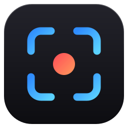

<p align="center"></p>

# OneShot — version 1.0.0

*[Versão em português](README.md)*

GNOME Shell extension for **screenshots** and **screen recording**, with a full
annotation editor and the same tools available **live while recording**.
Blue theme, custom icons, built for Wayland.

- UUID: `oneshot@vinicius`
- GNOME Shell: **51** (Fedora 44/45), Wayland
- License: GPL-2.0-or-later

## About me

I'm **Vini**, a Web Developer who loves GNOME and free software. I build
extensions that make the desktop prettier and more productive, like Orla Dock,
AeroTask and OneShot. Profile: [github.com/bispov19](https://github.com/bispov19).

## Features

### Capture
- **Selection overlay**: drag to select; handles to resize; drag inside (Select
  tool) to move; arrow keys move by 1 px (Shift = 10 px), Ctrl+arrows resize.
- Pixel dimensions and a **precision magnifier** with pixel color (hex) and coordinates.
- **Modes**: region, window (click a window), screen/monitor (click a
  monitor), direct full screen, specific monitor (panel menu) and **delayed
  capture** (countdown; click it to cancel).

### Editor (shortcut in parentheses)
| Tool | Key | | Tool | Key |
|---|---|---|---|---|
| Select/move | `S` | | Highlighter | `M` |
| Pencil | `P` | | Text | `T` |
| Line | `L` | | Numbered counter | `N` |
| Arrow | `A` | | Pixelate | `X` |
| Rectangle | `R` | | Blur | `B` |
| Filled rectangle | `F` | | Eraser | `D` |
| Ellipse | `E` | | Eyedropper | `I` |

- **Color & width**: `C` or right click opens the palette (quick colors, hex,
  width, font size). Mouse wheel or `+`/`-` change the width (or font size for
  text/counter).
- **Shift** while drawing: 45° lines, square rectangles/ellipses.
- Select tool: click a shape to select it, drag to move, `Delete` removes;
  changing color/width applies to the selected shape.
- Text: click to type (accents and input methods work); `Esc` or clicking
  outside commits; click an existing text to edit it.
- **Unlimited undo/redo**: `Ctrl+Z` / `Ctrl+Shift+Z` (or `Ctrl+Y`).

### Actions
| Action | Shortcut |
|---|---|
| Save to default folder | `Ctrl+S` or `Enter` |
| Copy to clipboard | `Ctrl+C` |
| Save as… | `Ctrl+Shift+S` |
| Pin to screen (floating) | `Ctrl+P` |
| Open with another app | `Ctrl+O` |
| Cancel | `Esc` |

**Pinned image**: drag to move, wheel = zoom, Ctrl+wheel = opacity, double
click closes; copy/save/close buttons on hover.

### Recording
- Same selection flow (switch to the video camera icon in the overlay, or use
  the recording shortcut). `Enter` or the ● button starts.
- Uses GNOME Shell's screencast service (`org.gnome.Shell.Screencast`),
  **WebM (VP8)**, configurable FPS and quality, optional cursor.
- **Panel indicator** with timer and annotate/pause/stop buttons.
- **Pause/resume**: each part is a segment, concatenated without re-encoding.
- **Audio** (optional): microphone and/or system audio via PipeWire/GStreamer
  (Opus), muxed into the video at the end.
- A red frame surrounds the recorded area (drawn outside it, so it's not recorded).

### Live annotation
- While recording, `Super+Shift+A` toggles annotation: the editor tools
  (except pixelate/blur/eyedropper) draw over the screen and **show up in the
  video**. When toggled off, drawings stay visible and clicks go back to apps.
  `Super+Shift+C` clears.
- Also works outside recordings (presentations).

## Global shortcuts (default)

| Action | Shortcut |
|---|---|
| Capture region | `Super+Shift+S` |
| Capture full screen | `Super+Shift+F` |
| Capture window | `Super+Shift+W` |
| Repeat last capture | `Super+Shift+L` |
| Start/stop recording | `Super+Shift+R` |
| Pause/resume recording | `Super+Shift+P` |
| Toggle live annotation | `Super+Shift+A` |
| Clear live annotations | `Super+Shift+C` |

All configurable in **Preferences › Shortcuts**, with conflict detection.

## Installation

Requirements (present on Fedora Workstation): GNOME Shell 51, GJS, GStreamer
with `gst-plugins-good` (vp8, webm, pulseaudio) and `gst-plugins-bad` (webp, optional).

```bash
git clone https://github.com/bispov19/oneshot.git
cd oneshot
./install.sh --copy     # copy into ~/.local/share/gnome-shell/extensions
# or ./install.sh       # symlink (development)
```

On **Wayland**, log out and back in, then:

```bash
gnome-extensions enable oneshot@vinicius
gnome-extensions prefs oneshot@vinicius
```

extensions.gnome.org package: `./install.sh --pack`.

Nested test session: `dbus-run-session gnome-shell --devkit`.
Logs: `journalctl --user -f -o cat /usr/bin/gnome-shell | grep -i oneshot`.

## Technical notes

- **Light on integrated GPUs**: the frozen screen is a GPU texture; annotations
  use two Cairo layers — the base redraws only on changes, the active layer is
  only as large as the shape being drawn.
- Final image compositing runs in a Shell worker thread.
- Lossy WebP goes through GStreamer (`webpenc`) because Fedora's GdkPixbuf
  (glycin) always writes lossless WebP.
- Everything created in `enable()` is destroyed in `disable()`.
