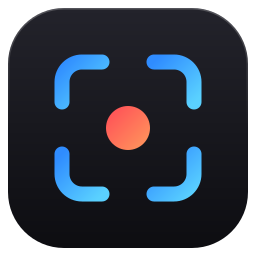

<p align="center"></p>

# OneShot — versão 1.0.0

*[English version](README.en.md)*

Extensão do GNOME Shell para **captura de tela** e **gravação de vídeo**, com
editor de anotações completo e as mesmas ferramentas disponíveis **ao vivo
durante a gravação**. Tema azul, ícones próprios, feita para Wayland.

- UUID: `oneshot@vinicius`
- GNOME Shell: **51** (Fedora 44/45), Wayland
- Licença: GPL-2.0-or-later

## Sobre mim

Sou o **Vini**, Web Developer apaixonado por GNOME e software livre. Crio
extensões que deixam o desktop mais bonito e produtivo, como o Orla Dock, o
AeroTask e o OneShot. Perfil: [github.com/bispov19](https://github.com/bispov19).

## Funções

### Captura
- **Overlay de seleção**: arraste para selecionar; alças para redimensionar;
  arraste dentro (ferramenta Selecionar) para mover; setas movem 1 px
  (Shift = 10 px), Ctrl+setas redimensionam.
- Dimensões em pixels e **lupa de precisão** com a cor do pixel (hex) e as coordenadas.
- **Modos**: região, janela (clique na janela), tela/monitor (clique no
  monitor), tela inteira direta, monitor específico (menu do painel) e
  **captura com atraso** (contagem regressiva; clique nela para cancelar).

### Editor (atalho entre parênteses)
| Ferramenta | Tecla | | Ferramenta | Tecla |
|---|---|---|---|---|
| Selecionar/mover | `S` | | Marca-texto | `M` |
| Lápis | `P` | | Texto | `T` |
| Linha | `L` | | Contador numerado | `N` |
| Seta | `A` | | Pixelar | `X` |
| Retângulo | `R` | | Desfocar | `B` |
| Retângulo preenchido | `F` | | Borracha | `D` |
| Elipse | `E` | | Conta-gotas | `I` |

- **Cor e espessura**: `C` ou clique direito abre a paleta (cores rápidas,
  hexadecimal, espessura, tamanho da fonte). Rolagem do mouse ou `+`/`-`
  mudam a espessura (ou a fonte, nas ferramentas de texto/contador).
- **Shift** ao desenhar: linhas a cada 45°, retângulos/elipses quadrados.
- Com a ferramenta Selecionar: clique numa forma para selecionar, arraste para
  mover, `Delete` remove, mudar cor/espessura aplica à forma selecionada.
- Texto: clique para escrever (acentos e métodos de entrada funcionam);
  `Esc` ou clique fora confirma; clique num texto existente para editá-lo.
- **Desfazer/refazer ilimitados**: `Ctrl+Z` / `Ctrl+Shift+Z` (ou `Ctrl+Y`).

### Ações
| Ação | Atalho |
|---|---|
| Salvar na pasta padrão | `Ctrl+S` ou `Enter` |
| Copiar para a área de transferência | `Ctrl+C` |
| Salvar como… (escolher local) | `Ctrl+Shift+S` |
| Fixar na tela (janela flutuante) | `Ctrl+P` |
| Abrir com outro aplicativo | `Ctrl+O` |
| Cancelar | `Esc` |

**Imagem fixada**: arraste para mover, rolagem = zoom, Ctrl+rolagem =
opacidade, duplo clique fecha; botões de copiar/salvar/fechar ao passar o mouse.

### Gravação
- Mesmo fluxo de seleção (no overlay, troque para o ícone de câmera de vídeo,
  ou use o atalho de gravação). `Enter` ou o botão ● inicia.
- Usa o serviço de screencast do GNOME Shell (`org.gnome.Shell.Screencast`),
  formato **WebM (VP8)**, FPS e qualidade configuráveis, cursor opcional.
- **Indicador no painel** com cronômetro e botões anotar/pausar/parar.
- **Pausar/retomar**: cada trecho vira um segmento que é concatenado ao final
  sem recodificar.
- **Áudio** (opcional): microfone e/ou áudio do sistema via PipeWire/GStreamer
  (Opus), mesclado ao vídeo no final.
- Moldura vermelha em volta da área gravada (desenhada por fora, não aparece no vídeo).

### Anotação ao vivo
- Durante a gravação, `Super+Shift+A` liga/desliga a anotação: as ferramentas
  do editor (exceto pixelar/desfocar/conta-gotas) desenham sobre a tela e
  **aparecem no vídeo**. Desligada, o desenho fica visível e os cliques voltam
  aos aplicativos. `Super+Shift+C` limpa.
- Também funciona fora da gravação (para apresentações).

## Atalhos globais (padrão)

| Ação | Atalho |
|---|---|
| Capturar região | `Super+Shift+S` |
| Capturar tela inteira | `Super+Shift+F` |
| Capturar janela | `Super+Shift+W` |
| Repetir última captura | `Super+Shift+L` |
| Iniciar/parar gravação | `Super+Shift+R` |
| Pausar/retomar gravação | `Super+Shift+P` |
| Alternar anotação ao vivo | `Super+Shift+A` |
| Limpar anotações ao vivo | `Super+Shift+C` |

Todos podem ser alterados em **Preferências › Atalhos**; conflitos com outros
atalhos do OneShot ou do sistema aparecem com um aviso amarelo.

## Preferências

Pasta de capturas (padrão: `Imagens/Capturas de tela`, o mesmo nome traduzido
que o GNOME usa) e de vídeos (padrão: `Vídeos/Screencasts` traduzido);
formato PNG/JPG/WebP e qualidade; padrão do nome do arquivo com prévia
(`%Y-%m-%d_%H-%M-%S`, `{mode}`…); cópia automática; atraso do timer; cursor;
som; lupa; botão no painel; notificações (com “Abrir”, “Abrir pasta” e
“Copiar”); cor/espessura/fonte padrão e lembrar a última ferramenta; cor de
destaque, escurecimento e tamanho dos ícones; FPS, qualidade, cursor e áudio
da gravação; botão **Restaurar padrões**.

## Instalação

Requisitos (já presentes no Fedora Workstation): GNOME Shell 51, GJS,
GStreamer com `gst-plugins-good` (vp8, webm, pulseaudio) e `gst-plugins-bad`
(webp, opcional).

```bash
git clone https://github.com/bispov19/oneshot.git
cd oneshot
./install.sh --copy     # instala uma cópia em ~/.local/share/gnome-shell/extensions
# ou ./install.sh       # link simbólico (desenvolvimento)
```

Em **Wayland** o GNOME Shell só encontra extensões novas ao iniciar a sessão:
**saia e entre de novo**, depois:

```bash
gnome-extensions enable oneshot@vinicius
gnome-extensions prefs oneshot@vinicius
```

Pacote para o extensions.gnome.org: `./install.sh --pack`.

### Testar sem sair da sessão

```bash
dbus-run-session gnome-shell --devkit
```

### Problemas

```bash
journalctl --user -f -o cat /usr/bin/gnome-shell | grep -i oneshot
```

- *Atalho não funciona*: veja o aviso de conflito em Preferências › Atalhos.
- *Gravação falha ao salvar*: os trechos ficam em `~/.cache/oneshot/rec-*`.

## Estrutura

```
extension.js            ponto de entrada (enable/disable) e coordenação
prefs.js, prefs/        preferências (Adw/GTK4), editor de atalhos e aba Sobre
lib/config.js           pastas, nome de arquivo (compartilhado com prefs)
lib/keybindings.js      atalhos globais
lib/notify.js           notificações com ações
lib/indicator.js        botão/menu do painel
lib/overlay/            overlay de seleção (região, janela, tela, lupa)
lib/editor/             formas, ferramentas e canvas (Cairo, 2 camadas)
lib/ui/                 barras, tooltips, popover de cor, contagem regressiva
lib/capture/            captura, imagem congelada, salvamento, WebP
lib/actions/            fixar na tela, salvar como, abrir com
lib/recorder/           gravação, áudio, indicador e moldura
lib/live/               anotação ao vivo
helpers/save-dialog.js  diálogo GTK do "Salvar como" (processo separado)
schemas/, icons/, stylesheet.css
```

## Notas técnicas

- **Leve para GPU integrada**: a tela congelada é uma textura da GPU; as
  anotações usam duas camadas Cairo — a base só é redesenhada quando algo
  muda, e a camada ativa tem apenas o tamanho da forma sendo desenhada.
- A imagem final é composta numa thread do Shell (`Shell.Screenshot.composite_to_stream`).
- WebP com perdas é gerado via GStreamer (`webpenc`): no Fedora, o GdkPixbuf
  usa o glycin, que grava WebP sempre sem perdas.
- Tudo o que é criado em `enable()` é destruído em `disable()`: atalhos,
  sinais, timers, atores, grabs, gravação em andamento, imagens fixadas.
